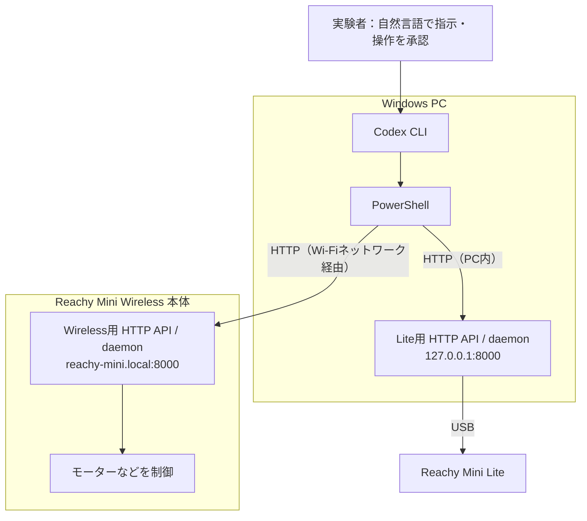

# Physical AI最終課題：Codex CLIで2体のReachy Miniを起動してみた

本課題では、Codex CLIを使って2体の[Reachy Mini](https://pollen-robotics.com/reachy-mini/)を操作しました。対象は、Windows PCにUSB接続した[Reachy Mini Lite](https://store.pollen-robotics.com/products/reachy-mini-lite-version)と、Wi-Fi経由で接続した[Reachy Mini Wireless](https://store.pollen-robotics.com/products/reachy-mini-wireless-version)です（以下、それぞれ「Lite」「Wireless」と表記）。Codexは公式HTTP APIにコマンドを送り、実験者はロボットの姿勢や音をその場で確認しました。

2026年11月2日、両機は通常の姿勢まで起き上がりました。その後、両機は頭とアンテナを収納姿勢に戻し、制御プログラムも停止しました。

## 接続構成

Lite用のAPIとdaemonはWindows PC上で動き、USB経由でLiteを制御します。Wireless用のAPIとdaemonは本体内で動きます。どちらもポート番号は8000ですが、接続先は異なります。Wirelessへの通信にはSSHを使用していません。

| 対象 | PowerShellからの接続先 |
|---|---|
| Lite | `http://127.0.0.1:8000`（Windows PC自身） |
| Wireless | `http://reachy-mini.local:8000`（Wireless本体） |

## この資料で使う用語

| 用語 | この資料での意味 |
|---|---|
| 起床（wake-up） | ロボットが頭とアンテナを動かし、通常の姿勢になることです。 |
| 収納 | ロボットが頭とアンテナを収納用の姿勢に戻すことです。 |
| daemon（デーモン） | ロボットの動作や状態を管理する制御プログラムです。 |
| HTTP API | PCからロボットの状態を調べたり、動作を指示したりするための窓口です。 |
| GET | 状態を問い合わせる要求です。 |
| POST | 起床や停止などの処理を依頼する要求です。 |

APIが要求を受け付けたことと、ロボットが実際に動いたことは、それぞれ確認する必要があります。そのため、この実験ではAPIの応答に加え、実験者による姿勢の確認を成功の条件としました。

## 実験で行ったこと

実験では、まずWirelessを起こし、次にLiteを起こしました。終了時には、Lite、Wirelessの順に収納して停止しました。

Codexがコマンドを実行する前に、実験者はその内容とロボットへの影響を確認し、操作ごとに承認しました。コマンドを送った後は、CodexがAPIの応答を確認しました。実験者は、それとは別に、ロボットが目的の姿勢になったことと、異音や引っかかりがないことを確認しました。

両機とも起床と収納に成功しました。ただし、今回停止したのはロボットを制御するプログラムです。本体の電源スイッチは操作していません。

## 資料の読み方

2体を順に操作するときは「2体の操作順序」を参照してください。各機の操作手順には、状態確認と起床・収納・停止のコマンドをまとめています。

| ファイル | 内容 |
|---|---|
| [2体の操作順序](pair-start-stop.md) | Wireless→Liteの起床と、Lite→Wirelessの収納・停止 |
| [Wirelessの操作手順](wireless-operations.md) | Wirelessの状態確認、起床、収納・停止のコマンド |
| [Liteの操作手順](lite-operations.md) | Liteの状態確認、起床、収納・停止のコマンド |

ここに記載した状態は、実験当時のものです。再実行するときは、その時点の状態を確認してください。

## 今回の成果と公式SDKとの関係

今回の起床・収納・停止実験のために、独自のプログラムは開発していません。成果として公開するのは、公式APIを呼び出すPowerShellコマンド、その実行手順、そして実機で確認した結果です。プロジェクト内にある別目的のコードは、今回の操作には使用していません。

APIとdaemonは、Pollen Roboticsが提供する公式SDK [pollen-robotics/reachy_mini](https://github.com/pollen-robotics/reachy_mini) の機能です。実験時にはSDK/daemon 1.13.0を使用しました。仕様の参照先は、公式の[REST API資料](https://github.com/pollen-robotics/reachy_mini/blob/main/docs/source/API/rest-api.mdx)と[daemonの実装](https://github.com/pollen-robotics/reachy_mini/blob/main/src/reachy_mini/daemon/daemon.py)です。リンク先のmainブランチは更新されるため、実験時の仕様と異なる場合があります。

Wirelessの起床は公式HTTP APIで成功しました。SSHは使用していません。また、両機の起床・収納・停止にOpenAI APIキーや有料APIは必要ありませんでした。2体が会話や撮影を連携して行う実験については、この資料では扱いません。

## 再実行する際の注意

コマンドはWindows PowerShell用です。Wirelessの接続先は本体の管理API、Liteの接続先はWindows PC上の管理APIです。各機の手順に記載した接続先を確認してください。

実験者は、頭とアンテナの周囲から手や物を離してください。Codexに操作を任せる場合も、状態の問い合わせを含め、操作ごとにコマンドと影響を確認して承認してください。異音、引っかかり、過負荷、想定外の動きが生じた場合は、追加の動作を指示せず、状態を確認してください。
