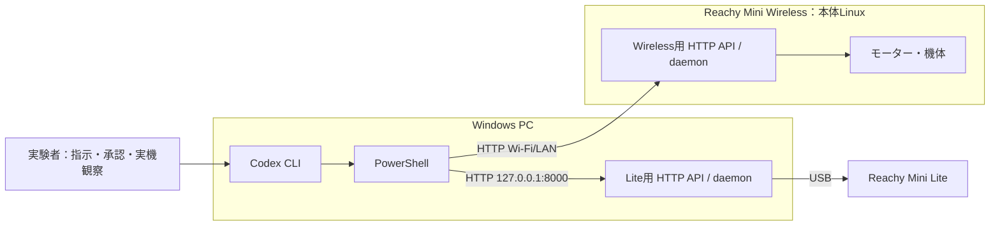

# Reachy Mini 2体のシステム構成と実行環境

この文書は、2026年11月2日の実機検証で確認した構成を記録します。記載したPythonやSDKの版は、すべての環境で必須という意味ではありません。機体の操作コマンドは[2体の操作順序](../pair-start-stop.md)と各機の手順を参照してください。

## 実行環境の配置



Pythonの仮想環境やWirelessのサービスはdaemonの実行環境です。Codexとは別に機体へ指示を送る操作主体ではありません。

## 今回確認した構成

| 項目 | Lite | Wireless |
|---|---|---|
| 接続 | USB / COM3（実証時の番号） | Wi-Fi / LAN |
| daemonの実行場所 | Windows PC | 本体Linux / ARM64 |
| Python | 3.12.16 | 3.12.12（daemonのvenv内） |
| venv | `runtime/lite/.venv` | `/venvs/mini_daemon` |
| Reachy Mini SDK/daemon | 1.13.0 | 1.13.0 |
| daemon管理サーバーの起動 | Windowsで`reachy-mini-daemon.exe`を実行 | `systemd` → `launcher.sh` → Python daemon |
| 実行ユーザー | Windows側の起動ユーザー | `pollen` |
| HTTP API | `http://127.0.0.1:8000` | `http://reachy-mini.local:8000` |

## Lite：管理サーバーの準備と確認

LiteをWindows PCへUSB接続し、電源とCOMポートの認識を確認します。実証時のポートはCOM3でしたが、再現環境では異なる場合があります。確認コマンドと、応答しない場合の注意点は[Liteの操作手順](../lite-operations.md#apiが応答しない場合)にあります。

今回の元の開発環境では、準備済みのWindows側venvから次のコマンドで管理サーバーを起動しました。元の作業ディレクトリを起点にした、**今回の配置に固有の例**です。この公開資料のリポジトリに`runtime/lite/.venv`は含まれません。

```powershell
$env:REACHY_MINI_LITE_AUDIO = '1'
& .\runtime\lite\.venv\Scripts\reachy-mini-daemon.exe --serialport COM3 --no-wake-up-on-start --no-goto-sleep-on-stop --fastapi-host 127.0.0.1
```

このプロセスは前景で動くため、操作中は終了させずに管理します。`REACHY_MINI_LITE_AUDIO`は今回の既存環境で使った設定であり、2体の起動・停止に一般的に必須とは確認していません。venvを最初に作成したコマンドや依存関係を導入した順序は未確認です。新しい環境の構築には[公式SDKの案内](https://github.com/pollen-robotics/reachy_mini)を参照してください。

管理サーバーが応答することを、機体を動かす前に確認します。

```powershell
Invoke-RestMethod -Method Get -Uri 'http://127.0.0.1:8000/api/daemon/status' -TimeoutSec 5
```

管理サーバー自体が起動していなければ、`POST /api/daemon/start`にはアクセスできません。HTTP API内でのdaemon制御開始と、管理サーバーのプロセス起動は別です。機体の起動・停止は[Liteの操作手順](../lite-operations.md)に従ってください。

## Wireless：本体側の起動経路と接続確認

実証時のWirelessは、本体Linux上で`systemd`から`launcher.sh`を経てPython daemonが起動する構成でした。確認したlauncherは`/venvs/mini_daemon/lib/python3.12/site-packages/reachy_mini/daemon/app/services/wireless/launcher.sh`にあり、venvを有効化して`python -u -m reachy_mini.daemon.app.main --wireless-version --no-wake-up-on-start`を実行します。表のPython 3.12.12はこのdaemon用venv内の版で、本体OSのデフォルトPythonの版を示しません。

Windows PCとWirelessが通信できるWi-Fi/LAN環境で、`reachy-mini.local`の名前解決とHTTP APIの応答を確認します。

```powershell
Invoke-RestMethod -Method Get -Uri 'http://reachy-mini.local:8000/api/daemon/status' -TimeoutSec 5
```

サービス起動経路の調査にはSSHを使用しましたが、最終的な機体の起動・停止はWindows上のCodex CLIからHTTP APIで操作し、SSHは使用していません。機体の起動・停止は[Wirelessの操作手順](../wireless-operations.md)に従ってください。
